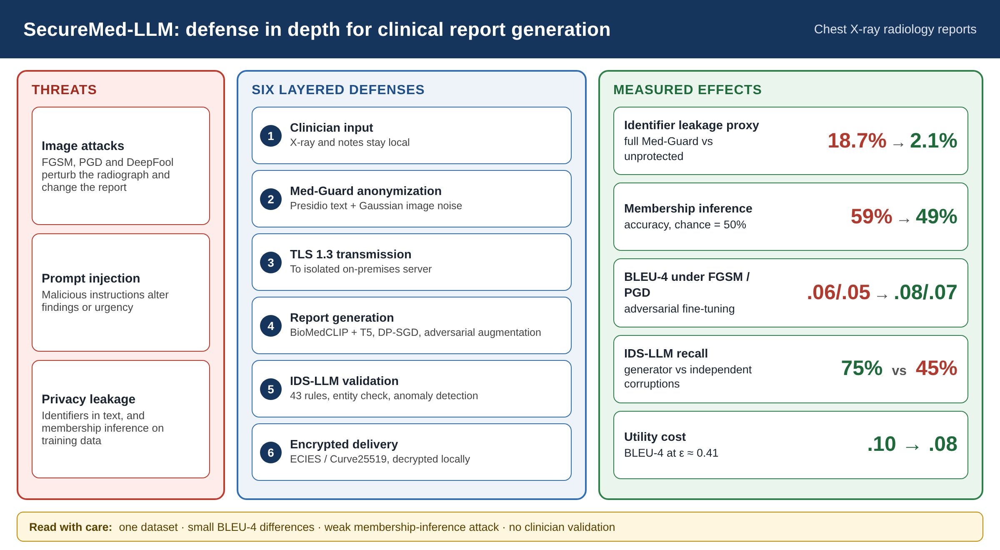
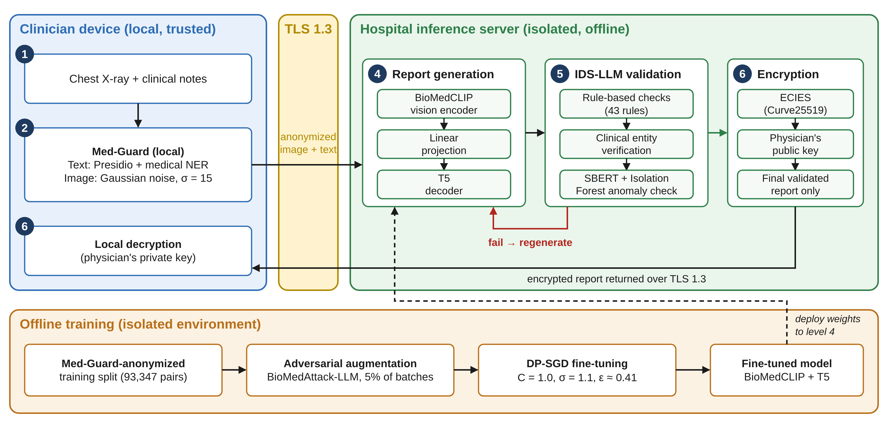
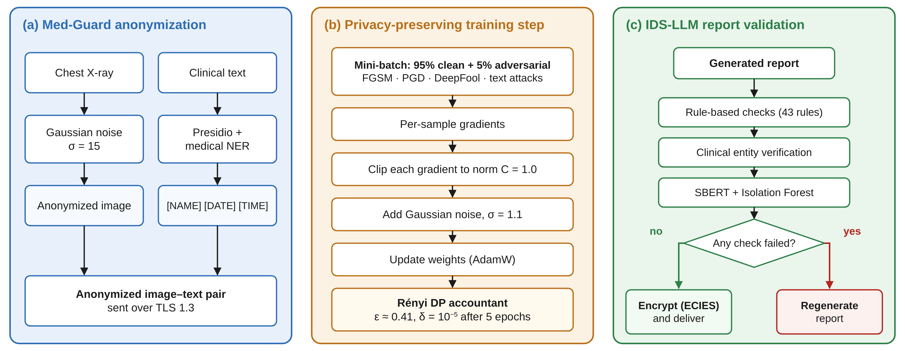
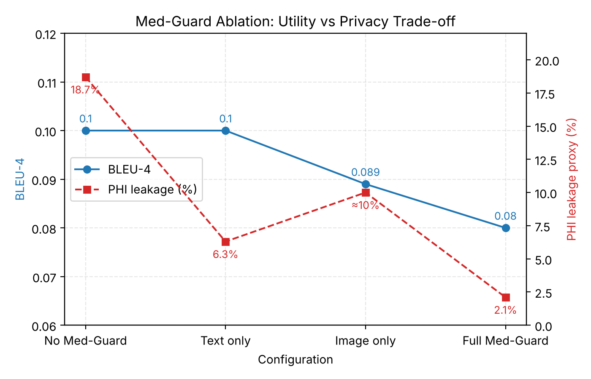
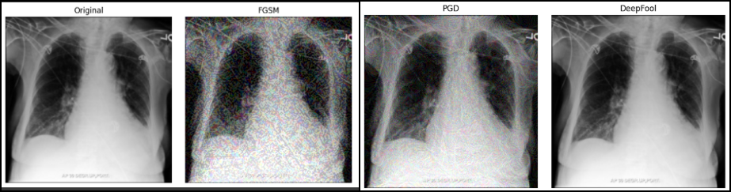
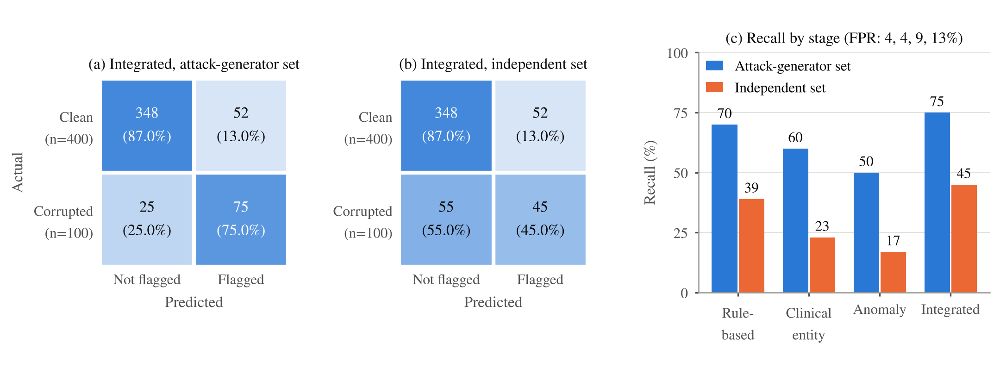

<div align="center">

# SecureMed-LLM

### Defense in Depth for Clinical Language Models
**Privacy-Preserving and Adversarially Robust Radiology Report Generation**


**Aya Boumezbeur** · **Fouzi Harrag** · **Khaled Shaalan**

*Submitted to IEEE Transactions on Medical Imaging (under review)*



</div>

---

## Contents

1. [Overview](#1-overview)
2. [Architecture](#2-architecture)
3. [Key results](#3-key-results)
4. [Limitations](#4-limitations)
5. [Repository structure](#5-repository-structure)
6. [Installation](#6-installation)
7. [Data](#7-data)
8. [Usage](#8-usage)
9. [Reproducibility details](#9-reproducibility-details)
10. [Citation](#10-citation)
11. [Authors](#11-authors)
12. [Disclaimer](#12-disclaimer)

---

## 1. Overview

Language models in clinical workflows face several threats at once: adversarial manipulation of medical images, prompt injection, and privacy leakage through identifiers in text or membership inference. Existing defenses usually address one threat at one stage.

**SecureMed-LLM** is a modular, multi-layered framework for chest X-ray report generation that stacks complementary protections across the whole pipeline:

| Layer | Component | Purpose |
|---|---|---|
| Input | **Med-Guard** | Local anonymization: Microsoft Presidio for text, Gaussian noise for images |
| Training | **DP-SGD** + adversarial augmentation | Bounded per-sample influence and robustness to image attacks |
| Output | **IDS-LLM** | Rule-based, entity and anomaly checks on generated reports |
| Delivery | **ECIES** (Curve25519) | Only the authorized physician can read the final report |

The goal is a measured, honest trade-off between privacy, robustness and report quality in a controlled setting, not a clinical product.

---

## 2. Architecture

SecureMed-LLM is an offline, on-premises pipeline with six sequential defense levels. Fine-tuning runs in a separate isolated environment on Med-Guard-anonymized data, and only the model weights are copied to the inference server.

<p align="center">
  
</p>

| Level | Stage | Details |
|---|---|---|
| 1 | Clinician input | Chest X-ray and clinical notes |
| 2 | **Med-Guard** | Presidio with medical NER replaces identifiers by placeholders; Gaussian noise (σ = 15) on pixels |
| 3 | Transmission | TLS 1.3 with forward secrecy to an isolated on-premises server |
| 4 | **Report generation** | Frozen BioMedCLIP ViT-B/16 vision encoder, linear projection to one prefix token, T5-base decoder |
| 5 | **IDS-LLM validation** | 43 hand-written rules, clinical entity verification, Sentence-BERT + Isolation Forest; failed reports are regenerated |
| 6 | Encrypted delivery | ECIES over Curve25519, decrypted locally by the physician |

### Module-level view

<p align="center">
  
</p>

- **(a) Med-Guard:** anonymization of image and text.
- **(b) Training step:** adversarial augmentation, per-sample gradient clipping, and Gaussian noise under a Rényi DP accountant.
- **(c) IDS-LLM:** three validation checks, with regeneration when any check fails.

---

## 3. Key results

All results use the public curated chest X-ray corpus (93,347 training, 1,885 validation, 1,541 test pairs) and are means over three seeds.

### 3.1 Privacy and utility

| Configuration | BLEU-4 | PHI-leakage proxy | Membership-inference accuracy |
|---|---|---|---|
| Unprotected | 0.10 | 18.7% | ≈ 59% (AUC 0.60) |
| Presidio only | 0.10 | 6.3% | n/a |
| Image noise only (σ = 15) | 0.089 | ≈ 10% | n/a |
| Adversarial training only | 0.098 | 16.1% | n/a |
| DP-SGD only | 0.09 | 15.2% | 51% (AUC 0.51) |
| Full Med-Guard | 0.08 | 2.1% | n/a |
| **Full pipeline** | **0.09** | **2.1%** | **49%** (AUC 0.49) |

Differential privacy: clipping norm C = 1.0, noise multiplier σ = 1.1, giving **(ε ≈ 0.41, δ = 10⁻⁵)** under the Rényi accountant of Opacus 1.6.0. Chance level for membership inference is 50%.

<p align="center">
  
</p>

### 3.2 Robustness to adversarial images

Corpus-level BLEU-4 on the test set, with an L∞ budget of 0.1 on [0, 1] pixels.

| Input | Before adversarial fine-tuning | After |
|---|---|---|
| Clean | 0.08 | 0.08 |
| FGSM | 0.06 | 0.08 |
| PGD | 0.05 | 0.07 |
| DeepFool | 0.08 | 0.07 |

<p align="center">
  
</p>

Under prompt injection, the correct-response rate (automated proxy) rises from 37.5% with no defense to 67.3% with adversarial fine-tuning and 78.3% with adversarial fine-tuning plus DP-SGD.

### 3.3 IDS-LLM validation

400 clean validation reports and two sets of 100 corrupted reports: set A from the attack generator, set B from independent deterministic perturbations.

| Stage | FPR | Recall (set A) | Recall (set B) |
|---|---|---|---|
| Rule-based | 4.0% | 70.0% | 39.0% |
| Entity verification | 4.0% | 60.0% | 23.0% |
| Anomaly detection | 9.0% | 50.0% | 17.0% |
| **Integrated (any stage)** | **13.0%** | **75.0%** | **45.0%** |

<p align="center">
  
</p>

### 3.4 Latency

End-to-end CPU latency is **6.5 ± 2.3 s** per report (100 test reports, Intel Xeon 2.0 GHz). This suits near-real-time support in non-urgent workflows, not emergency triage.

---

## 4. Limitations

Please read these before reusing the results.

- **Single dataset.** All results come from one curated corpus from two institutions. Generalization to other modalities, languages and institutions is not demonstrated, and patient-level overlap between splits cannot be excluded.
- **Weak utility metric.** BLEU-4 measures lexical overlap, not clinical correctness. Differences between configurations are small (0.01 to 0.03) and should be read only relatively.
- **Weak privacy attack.** The membership-inference attack is simple. The formal DP guarantee, not the empirical 49%, is the main privacy argument, and it holds only under the stated assumptions.
- **Circular PHI proxy.** The same Presidio detector family anonymizes and measures.
- **IDS-LLM is not a general detector of clinical errors.** Recall falls to 45% on corruptions independent of the attack generator.
- **Transferred attacks.** Image attacks come from a ResNet18 surrogate, not from BioMedCLIP; white-box and adaptive attacks are not evaluated.
- **No clinician validation.** Labels and rules were not reviewed by radiologists.
- **Encryption scope.** Only the final report is encrypted; the inference server is assumed trusted and on-premises.
- **Compliance.** The components are technically consistent with HIPAA and GDPR requirements, but formal compliance has not been verified.

---

## 5. Repository structure

```
.
├── assets/                 # Figures used in this README
├── medguard_text.py        # Presidio-based text de-identification
├── medguard_image.py       # Gaussian-noise image anonymization
├── pipeline.py             # End-to-end pipeline
├── encrypt_report.py       # ECIES / Curve25519 encryption
├── decrypt_report.py       # Local decryption
├── scripts/
│   ├── train.py            # DP-SGD + adversarial fine-tuning
│   ├── inference.py        # Report generation
│   └── evaluate.py         # Metrics and attack evaluation
├── docs/
│   └── ARCHITECTURE.md     # Detailed architecture notes
└── README.md
```

---

## 6. Installation

```bash
git clone https://github.com/boumezbeuraya/SecureMed-LLM-A-Privacy-Preserving1-Framework-for-Safeguarding-Clinical2-Language-Models.git
cd SecureMed-LLM-A-Privacy-Preserving1-Framework-for-Safeguarding-Clinical2-Language-Models

python -m venv .venv
source .venv/bin/activate        # Windows: .venv\Scripts\activate
pip install -r requirements.txt
```

Main dependencies: PyTorch 2.6.0, Opacus 1.6.0, Hugging Face Transformers, Microsoft Presidio, Scikit-learn, Sentence-Transformers and TorchAttacks.

---

## 7. Data

The experiments use the **curated-CXR** report-generation corpus on Kaggle, which its documentation describes as curated from MIMIC-CXR and Indiana University Open-I:

<https://www.kaggle.com/datasets/financekim/curated-cxr-report-generation-dataset/data>

- No patient data are redistributed in this repository.
- MIMIC-CXR is governed by the PhysioNet credentialed-access agreement. Its portion was used only as redistributed in the Kaggle corpus, so results should be re-verified on the official PhysioNet release by readers with credentialed access.
- Training uses the released `df_train.csv`; results are computed on the non-augmented `df_test.csv`.

---

## 8. Usage

```bash
# 1. Fine-tune with DP-SGD and adversarial augmentation
python scripts/train.py

# 2. Generate reports
python scripts/inference.py

# 3. Evaluate utility, privacy and robustness
python scripts/evaluate.py
```

Run each script with `--help` to see its options.

---

## 9. Reproducibility details

| Item | Value |
|---|---|
| Optimizer | AdamW, learning rate 2e-5 |
| Batch size / epochs | 16 / 5 |
| Gradient clipping norm | 1.0 |
| DP-SGD | C = 1.0, σ = 1.1, Poisson sampling rate ≈ 1.71e-4, 29,170 steps |
| Privacy budget | ε ≈ 0.41, δ = 1e-5 (Rényi accountant, Opacus 1.6.0) |
| Image size | 224 × 224, ImageNet normalization, no random augmentation |
| Text | Lowercased, T5 tokenizer, 128 tokens |
| Med-Guard noise | Gaussian, σ = 15 (SSIM ≈ 0.81) |
| Adversarial injection | 5% of training images, FGSM / PGD / DeepFool on a ResNet18 surrogate |
| Seeds | 3 |
| Hardware | NVIDIA T4 and P100 GPUs (Google Colab, Kaggle) |

Hosted notebooks were acceptable here because the corpus is public and de-identified. They do not satisfy the isolation assumed for clinical deployment, where fine-tuning would run in an isolated on-premises environment.

---

## 10. Citation

If you use this work, please cite:

```bibtex
@article{boumezbeur2026securemedllm,
  title   = {Defense in Depth for Clinical Language Models: Privacy-Preserving and Adversarially Robust Radiology Report Generation},
  author  = {Boumezbeur, Aya and Harrag, Fouzi and Shaalan, Khaled},
  journal = {IEEE Transactions on Medical Imaging},
  year    = {2026},
  note    = {Under review}
}
```

Update this entry with the volume, pages and DOI once the paper is published.

---

## 11. Authors

| Author | Affiliation |
|---|---|
| **Aya Boumezbeur** | Department of Computer Science, University of Ferhat Abbas, Setif, Algeria |
| **Fouzi Harrag** (corresponding author) | Department of Computer Science, University of Ferhat Abbas, Setif, Algeria |
| **Khaled Shaalan** | Faculty of Engineering & IT, The British University in Dubai, UAE |

---

## 12. Disclaimer

This is a research prototype. It is not a medical device and must not be used for clinical decision making.
